# CoreStream – Manual de usuario

CoreStream organiza el trabajo de equipos de desarrollo en aplicaciones, épicas y tickets, con avisos en tiempo real. Este manual describe la interfaz en español. Las capturas se tomaron con datos de ejemplo.

Para instalar o desplegar la aplicación, consulta el [Manual de instalación](MANUAL_INSTALACION.md).

## Contenido

1. [Conceptos básicos](#conceptos-básicos)
2. [Roles y permisos](#roles-y-permisos)
3. [Acceso](#acceso)
4. [Ciclo de vida de un ticket](#ciclo-de-vida-de-un-ticket)
5. [Guía del desarrollador](#guía-del-desarrollador)
6. [Guía del administrador y del líder](#guía-del-administrador-y-del-líder)
7. [Soporte, incidencias y reuniones](#soporte-incidencias-y-reuniones)
8. [Notificaciones y ajustes](#notificaciones-y-ajustes)
9. [Problemas habituales](#problemas-habituales)

## Conceptos básicos

- **Aplicación:** producto o proyecto.
- **Épica:** bloque de trabajo dentro de una aplicación, con fecha límite opcional.
- **Ticket:** tarea asignable a una persona; pertenece a una épica.
- **Subtarea:** paso de un ticket; puede convertirse en un ticket independiente.
- **Ticket de soporte:** bug con su propio flujo de investigación.
- **Incidencia:** problema operativo con severidad P1, P2 o P3.

Las funciones dependen también del plan de la organización:

| Función | Basico | Pro | Enterprise |
| --- | --- | --- | --- |
| Proyectos, tickets, documentos, soporte, incidencias, reuniones y webhooks | Sí | Sí | Sí |
| Analítica y traducción de documentos | No | Sí | Sí |
| Exportación de auditoría | No | No | Sí |

Una organización puede tener excepciones a su plan.

## Roles y permisos

Hay tres roles; el administrador gestiona el trabajo, pero no ejecuta tickets.

| Acción | Administrador | Líder de equipo | Desarrollador |
| --- | --- | --- | --- |
| Crear y editar aplicaciones y épicas | Sí | Sí | No |
| Crear, reasignar y borrar tickets | Sí | Sí | No |
| Editar un ticket y sus subtareas | Sí | Sí | Solo si es suyo |
| Comenzar un ticket | No | Si está libre o es suyo | Si está libre o es suyo |
| Completar o preguntar | No | Solo si es suyo | Solo si es suyo |
| Resolver una pregunta | Sí | Sí | No |
| Redireccionar | Sí | Sí | Solo si es suyo |
| Subir y descargar documentos | Sí | Sí | Sí |
| Borrar documentos | Sí | Sí | Solo los propios |
| Asignar tickets de soporte | No | Sí | No |
| Reportar y comentar incidencias | Sí | Sí | Sí |
| Asignar, resolver o cerrar incidencias | Sí | Sí | No |
| Agendar reuniones | Sí | Sí | No |
| Ver analítica del equipo, según plan | Sí | Sí | No |
| Gestionar usuarios, 2FA de la organización y webhooks | Sí | No | No |

## Acceso

Se entra por invitación: no hay registro público.

### Primera vez

1. Abre el enlace que te entregó tu administrador. Caduca a los 7 días y sirve una sola vez.
2. Escribe tu nombre y una contraseña de al menos 8 caracteres.
3. Pulsa **Crear cuenta** y después **Ir a iniciar sesión**.

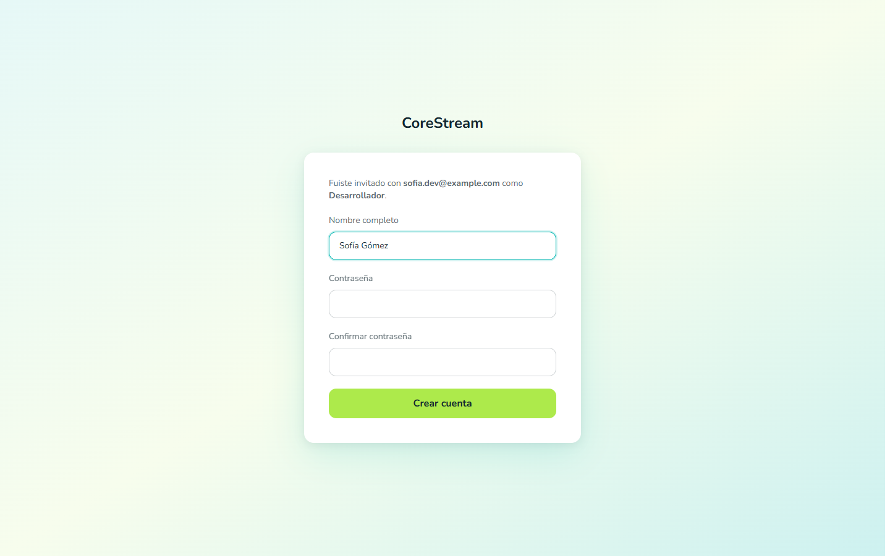

### Iniciar sesión

Escribe correo y contraseña. Si la organización lo tiene configurado, puedes usar **Continuar con** Google o Microsoft; el correo debe tener ya una cuenta de CoreStream.

Tras 8 intentos con el mismo correo en 5 minutos, espera antes de volver a probar.

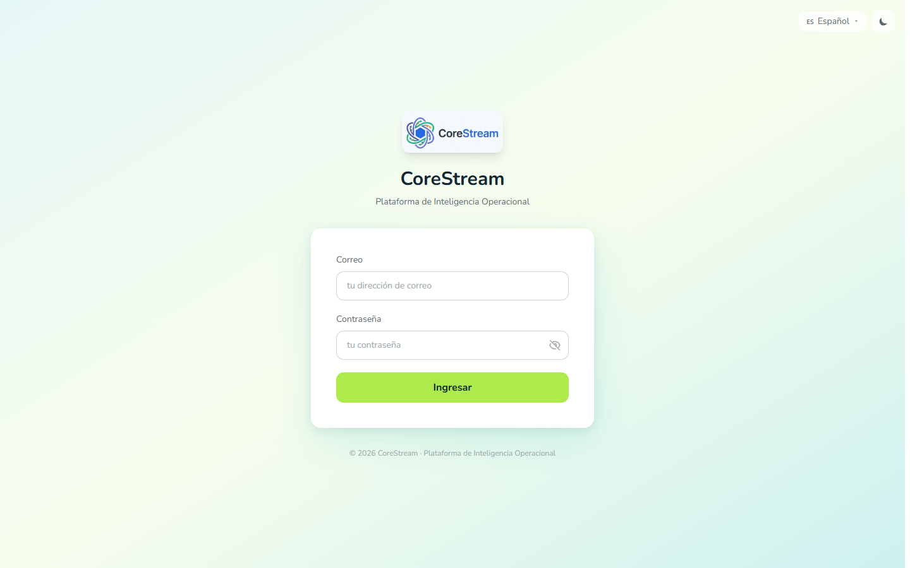

### Verificación en dos pasos

El administrador decide su activación. Si la exige, la configuras al iniciar sesión:

1. Escanea el QR con una app autenticadora o escribe la clave.
2. Introduce el código de 6 dígitos.
3. Copia o descarga los códigos de recuperación: solo se muestran una vez y cada uno sirve una vez.

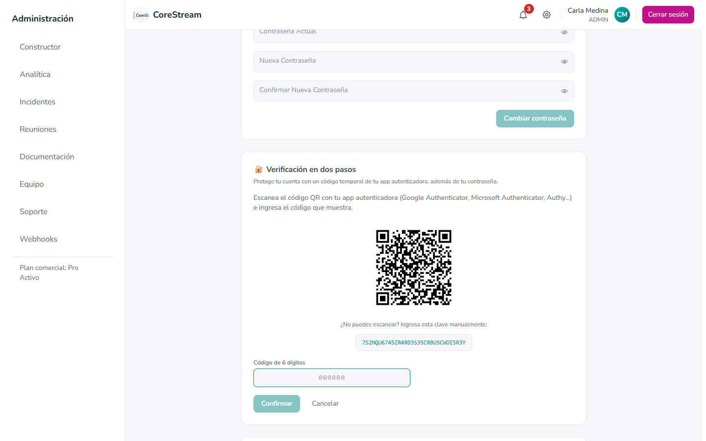

Sin acceso a la app, elige **Usar un código de recuperación**. Si tampoco los tienes, pide al administrador que restablezca tu 2FA.

## Ciclo de vida de un ticket

Un ticket solo se completa desde En progreso, y un ticket completado no se puede reabrir.

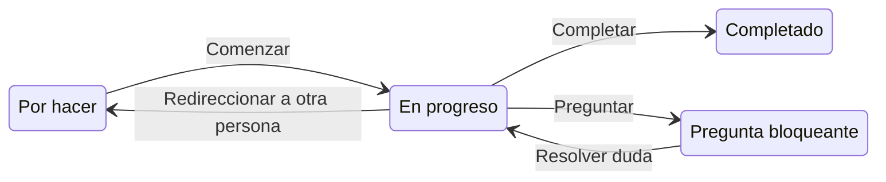

El tiempo de trabajo y el de bloqueo se registran por separado. Un ticket también puede redireccionarse cuando está en Por hacer.

## Guía del desarrollador

Tu trabajo diario está en **Workbench**, con las pestañas **Mi trabajo** y **Por Épica**.

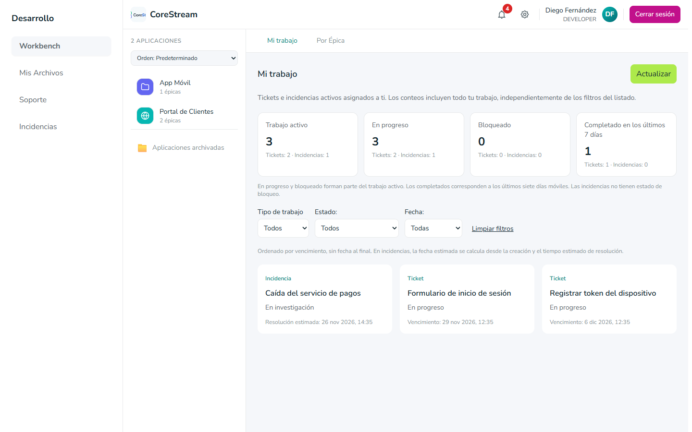

### Trabajar en un ticket

1. En **Workbench**, abre un ticket. Puedes filtrar por estado y fecha.
2. Pulsa **Comenzar Ticket**. Si no tenía responsable, pasa a ser tuyo y empieza a contar el tiempo.
3. Añade y marca subtareas. El botón **↑ Ticket** convierte una en ticket.
4. Pega el **Enlace del Pull Request** de GitHub, GitLab o Bitbucket.
5. Pulsa **Completar Ticket**. Solo se activa con un enlace válido.

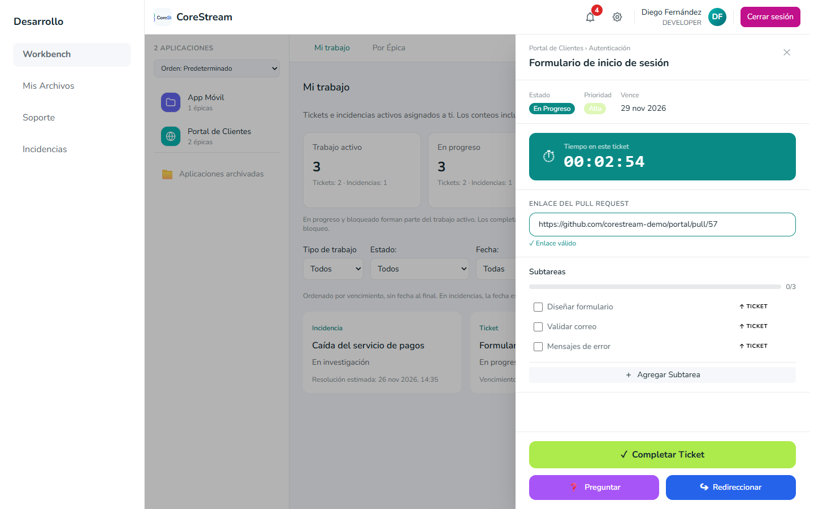

### Pedir ayuda o pasar el ticket

- **Preguntar:** con el ticket en progreso, escribe entre 10 y 500 caracteres. El ticket se bloquea hasta que respondan un líder o un administrador.
- **Redireccionar:** elige a la persona e indica el motivo. El ticket vuelve a Por hacer con el nuevo responsable.

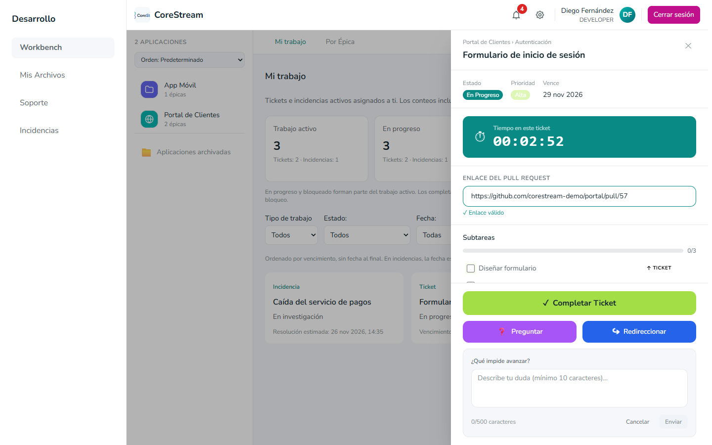

### Archivos

En **Mis Archivos**, asocia el archivo a una épica o ticket, si quieres, y súbelo. El máximo es 25 MB; se admiten formatos de código, documentación y datos, como `.py`, `.ts`, `.md`, `.pdf`, `.docx`, `.json` y `.csv`.

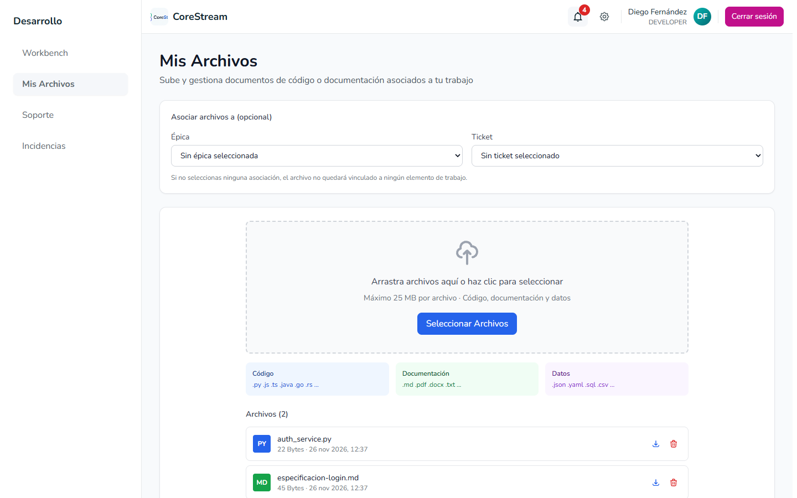

## Guía del administrador y del líder

El administrador entra en **Administración**. El líder entra en **Desarrollo**; para el Constructor, Analítica y Reuniones pulsa **Administración** en su menú, o abre `/#/admin/builder`. Con **Desarrollo** vuelve a su área.

### Crear el plan de trabajo

1. En **Constructor**, pulsa **Nueva aplicación** e indica nombre, descripción, color e icono.
2. Selecciónala y pulsa **Nueva épica**.
3. Dentro de la épica, pulsa **Agregar Ticket**, escribe el título y pulsa Enter.
4. Abre el ticket para definir descripción, responsable y prioridad.

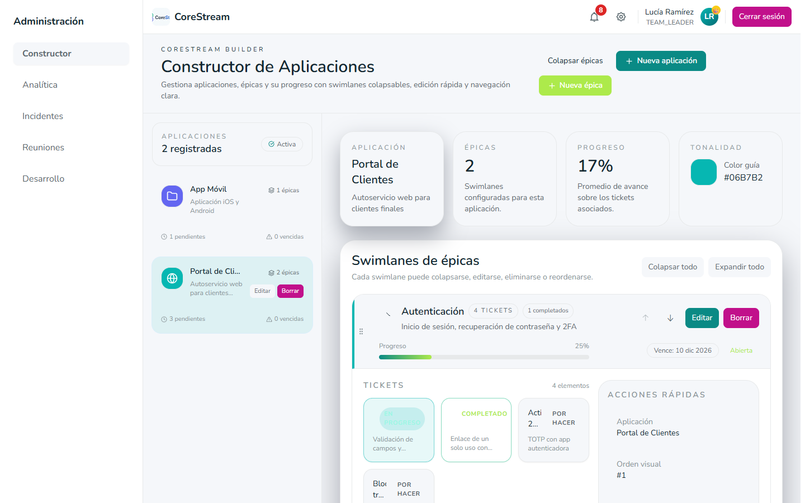

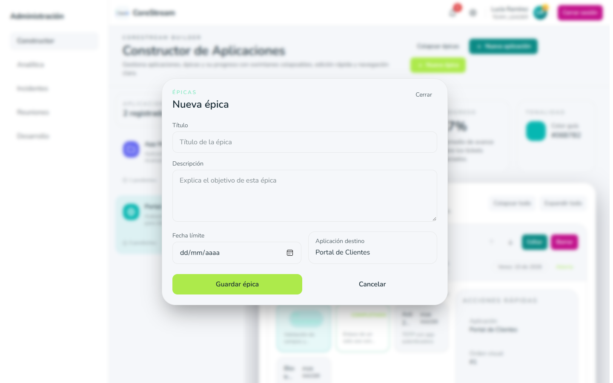

Las épicas se reordenan arrastrándolas o con las flechas. Los tickets se arrastran entre épicas.

### Asignar y desbloquear

- **Líder:** en **Asignación de Equipo**, elige una aplicación, filtra los tickets sin asignar y pulsa **Asignar**. La carga se mide sobre 10 tickets por persona.
- **Pregunta bloqueante:** abre el ticket, escribe la respuesta y pulsa **Resolver Duda**.

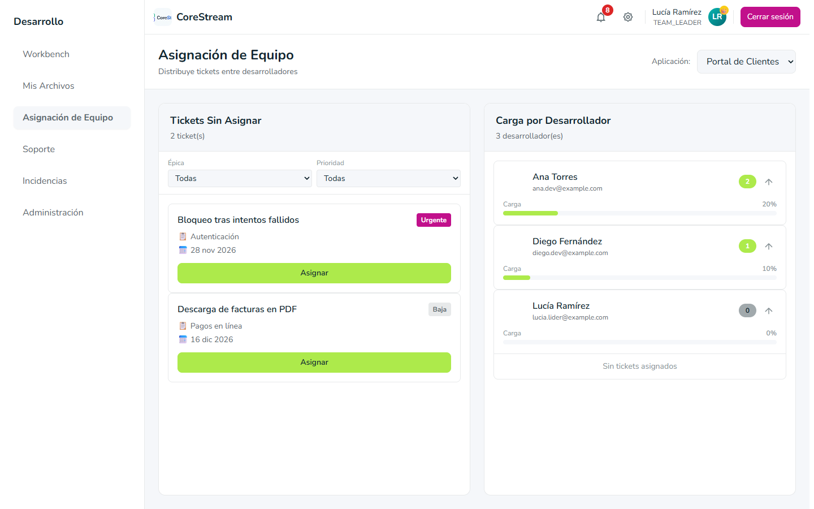

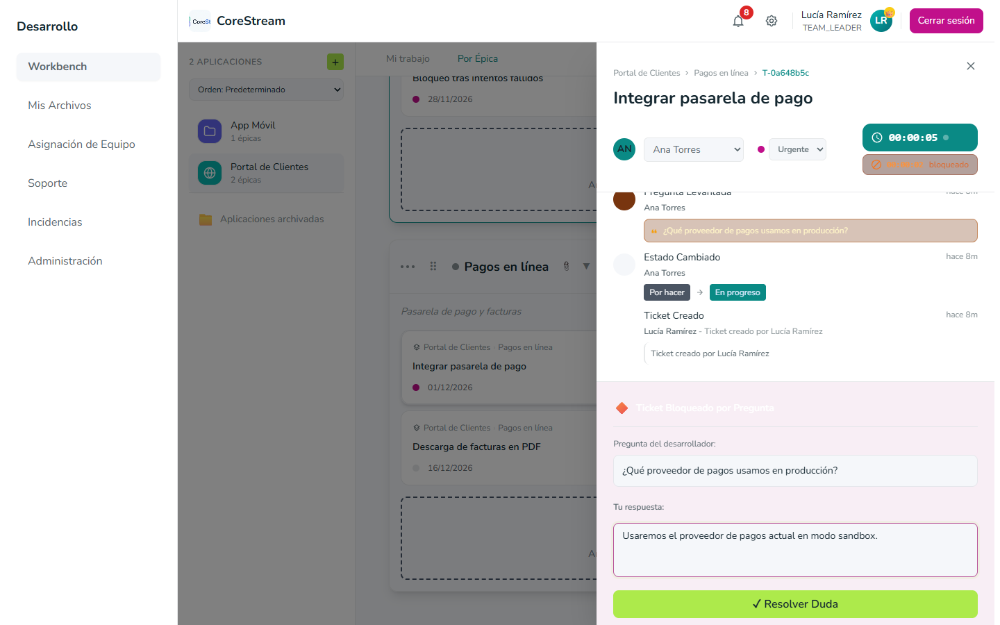

### Analítica

Muestra eficiencia, bloqueos, redirecciones, rendimiento, burndown, actividad semanal y soporte. Elige aplicación y período; puedes exportar a PDF o CSV. Requiere plan Pro o Enterprise.

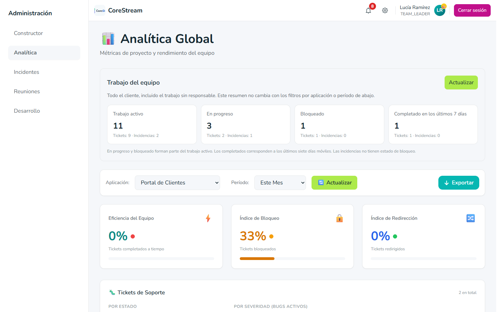

### Solo administrador

- **Invitar:** en **Equipo**, pulsa **Invitar Miembro**, indica correo y rol, y entrega el enlace. CoreStream no lo envía por correo y solo lo muestra una vez.
- **Gestionar miembros:** edita la especialidad, promueve o degrada y restablece el 2FA.
- **Dar de baja:** elige **Desactivar**, que conserva el historial. **Eliminación Total** es irreversible, y el servidor la rechaza si la persona tiene tickets o eventos asociados.
- **Exigir 2FA:** activa antes el tuyo en **Configuración** y después la política de la organización.
- **Documentación:** consulta, descarga y, según el plan y la configuración, traduce los archivos.
- **Webhooks:** pulsa **Nuevo webhook** e indica URL, formato JSON o Slack, proyecto y eventos; sin eventos seleccionados se envían todos. Guarda el secreto, que solo se muestra una vez, y usa **Enviar prueba**. Los envíos fallidos se reintentan hasta 3 veces y pueden repetirse desde **Entregas**.

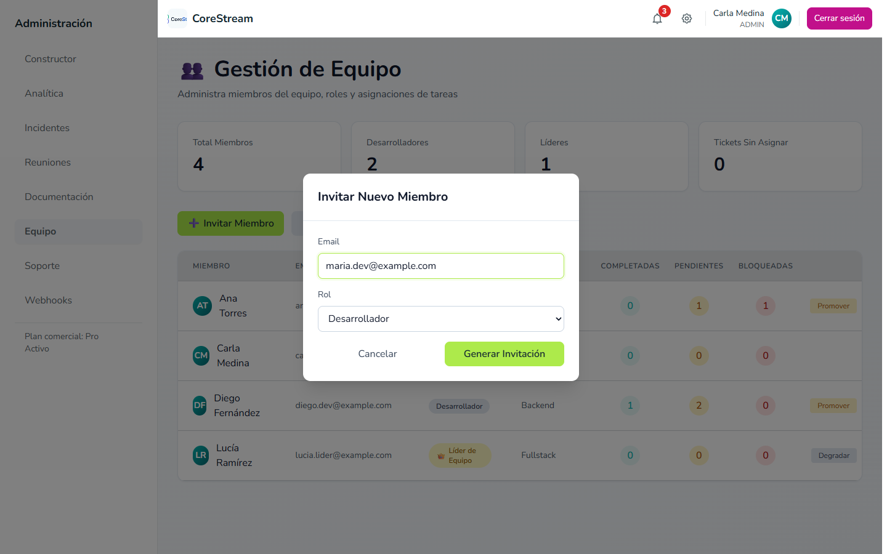

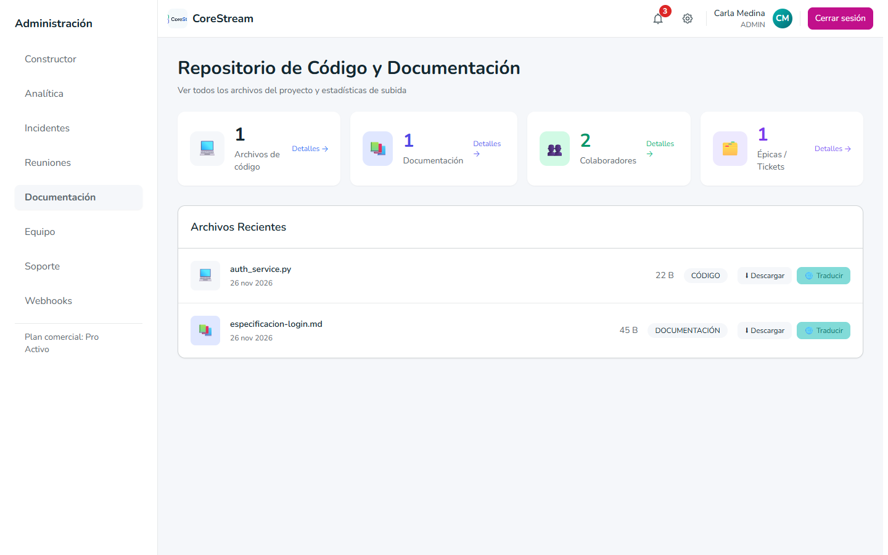

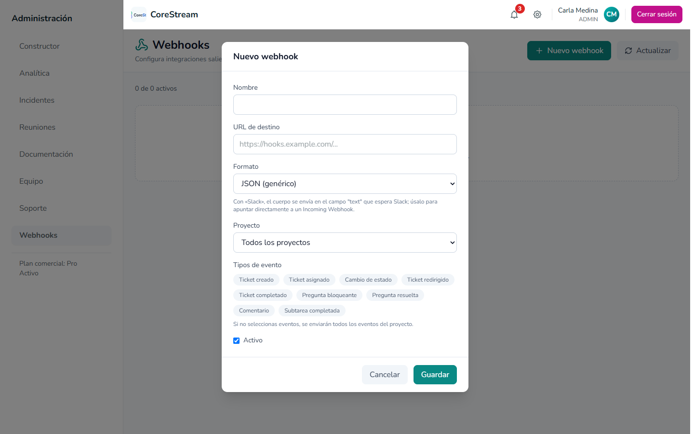

### Consola de planes

Solo la ven los operadores internos autorizados, con el enlace **Administración de plataforma** de la cabecera. Permite cambiar el plan de un cliente y activar o desactivar funciones. El cambio se aplica en la siguiente petición.

## Soporte, incidencias y reuniones

Usa Soporte para bugs que se resuelven con código e Incidencias para problemas operativos.

### Tickets de soporte

1. En **Soporte**, pulsa **+ Reportar Bug**. Solo el título es obligatorio; los pasos de reproducción y el stack trace ayudan.
2. Un líder lo asigna.
3. Quien lo atiende pulsa **Iniciar Investigación**.
4. Con un enlace de PR válido, pulsa **Marcar como Resuelto**.

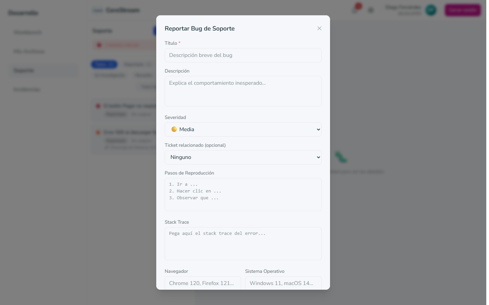

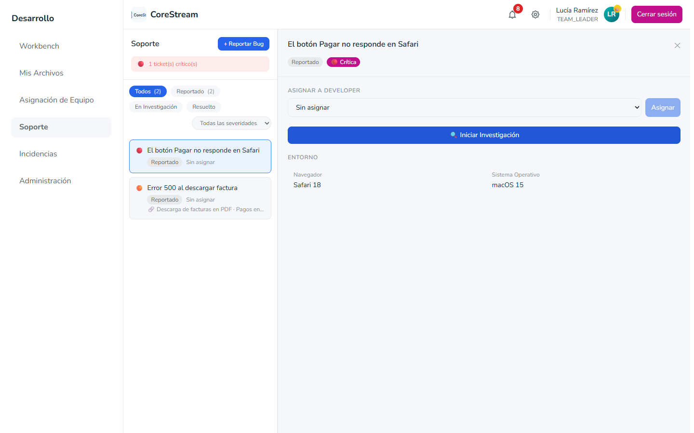

### Incidencias

1. Pulsa **Reportar incidencia** e indica título, categoría, severidad, entorno y tiempo estimado **en segundos** (1 hora = 3600).
2. Un administrador o líder asigna un responsable.
3. El responsable pulsa **Tomar / retomar**, documenta la mitigación y elige **Mitigar** o **Enviar a revisión**.
4. Un administrador o líder la resuelve desde revisión; después puede cerrarla o reabrirla.

Las P1 y P2 abiertas aparecen en **Atención**. Todos los cambios quedan en **Historial**. El menú de administración la llama **Incidentes**.

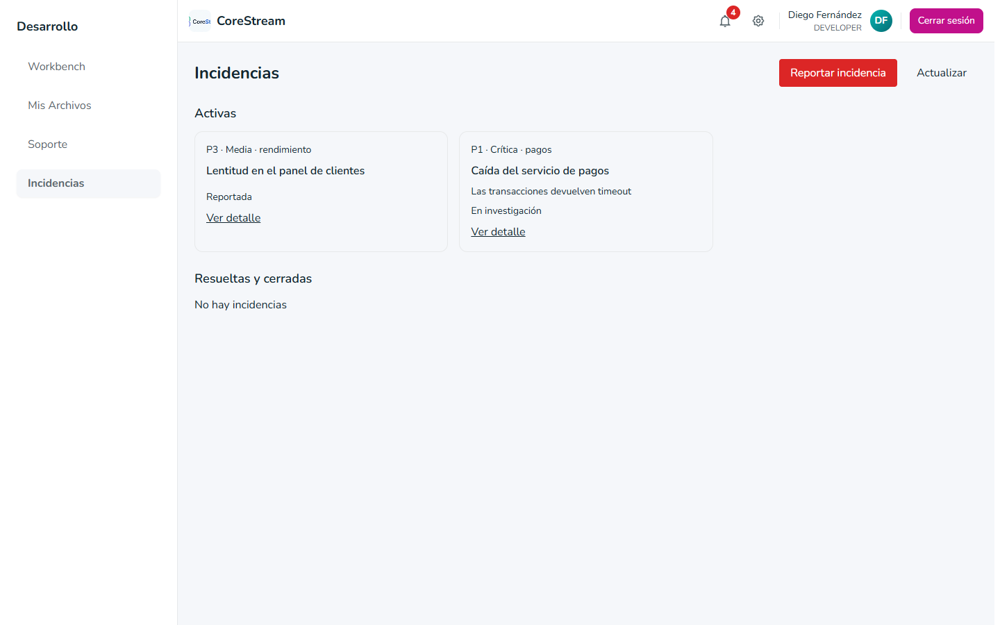

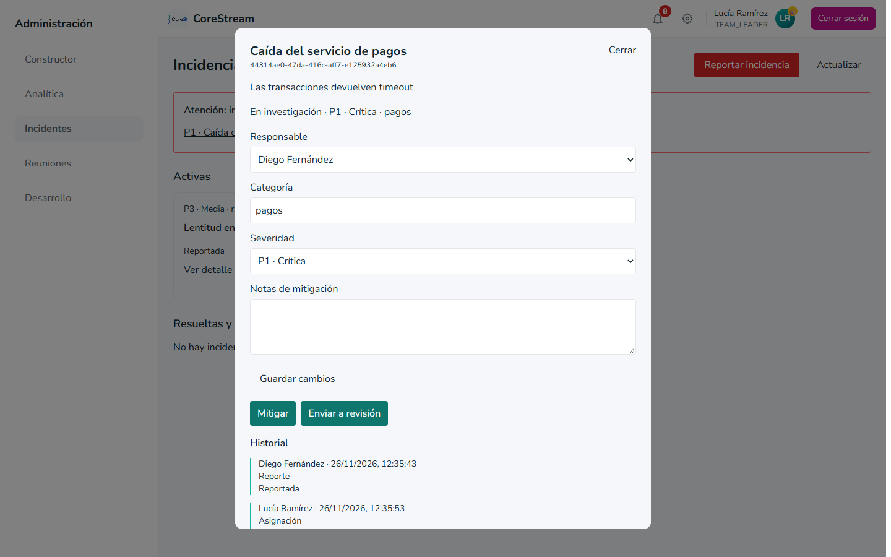

### Reuniones

En **Reuniones**, pulsa **Agendar Ceremonia** e indica título, tipo, fecha, hora y duración en minutos (30 por defecto). Registra después la asistencia (Presente, Ausente o Justificado) y el acta, que admite Markdown.

Los tipos disponibles son Daily Scrum, Sprint Planning, Retrospectiva, Refinamiento y Otra Ceremonia.

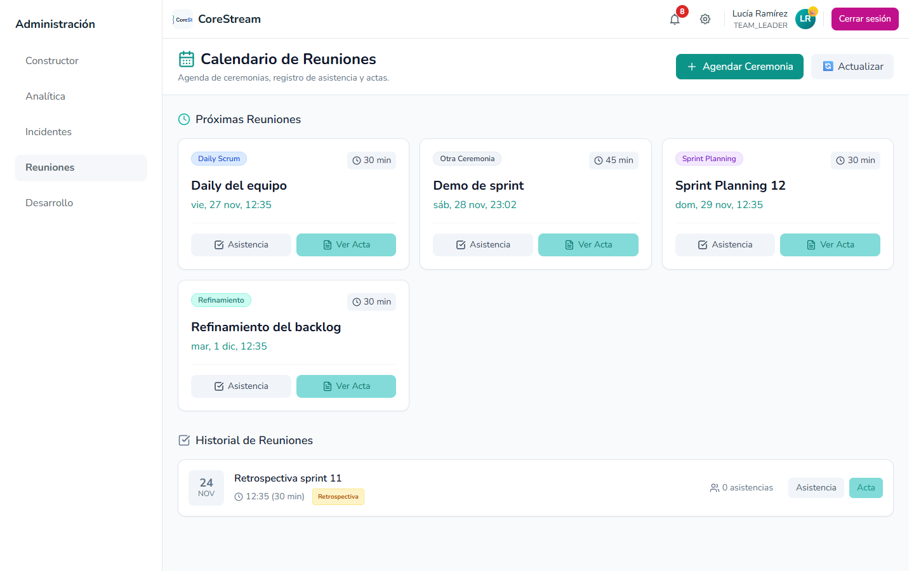

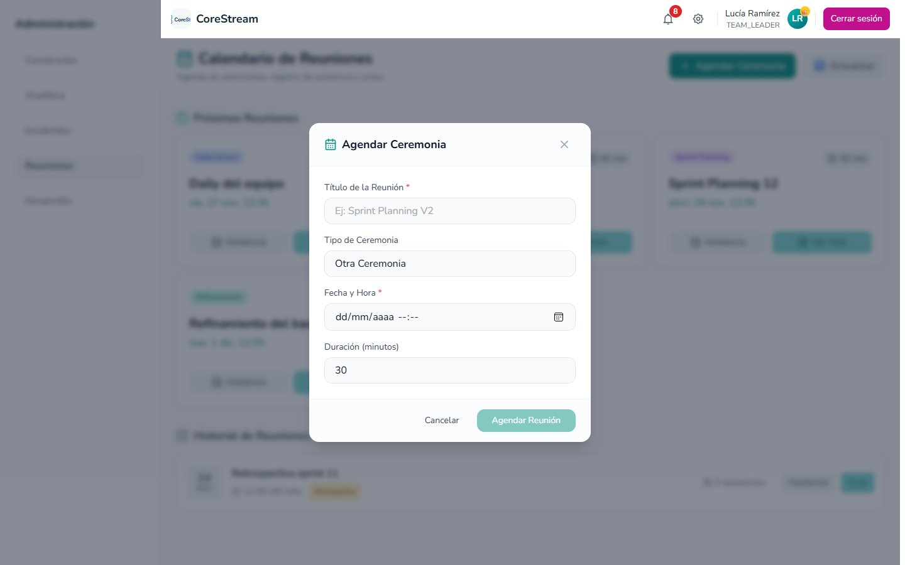

## Notificaciones y ajustes

La campana avisa de asignaciones, cambios de estado, redirecciones, tickets completados, preguntas e incidencias. Puedes filtrar por tipo y marcar todo como leído; al abrir un aviso se llega a su ticket o incidencia.

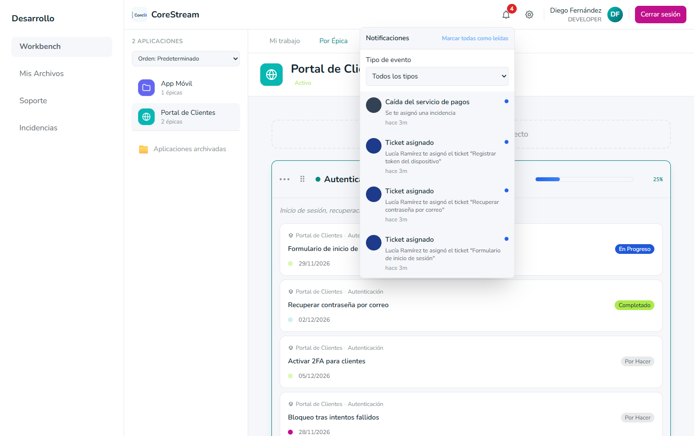

El botón **Ajustes** de la cabecera abre los ajustes rápidos, con acceso a la página completa. También puedes abrirla en `/#/dev/settings` o, para administradores, en `/#/admin/settings`:

- **Perfil:** nombre, apellido y especialidad. El correo no se edita.
- **Contraseña:** indica la actual y la nueva, de al menos 8 caracteres. Si un administrador la restableció, hay que cambiarla antes de continuar.
- **Verificación en dos pasos:** estado y regeneración de los códigos.
- **Preferencias:** modo oscuro e idioma (español, inglés, francés, alemán o portugués).

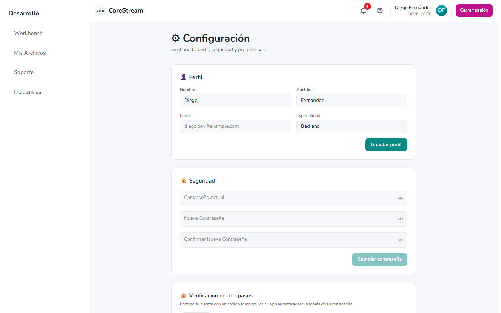

## Problemas habituales

Si el problema persiste, contacta con tu administrador.

| Problema | Qué hacer |
| --- | --- |
| La invitación no es válida | Ha caducado o ya se usó; pide otra |
| «No existe una cuenta de CoreStream con ese correo» | El SSO no crea cuentas; pide una invitación |
| Demasiados intentos | Espera 5 minutos |
| **Completar Ticket** está desactivado | Añade un enlace de PR válido; el de ejemplo no sirve |
| No puedo enviar una pregunta | El ticket debe estar en progreso |
| No puedo comenzar un ticket | Es de otra persona o eres administrador |
| No puedo tomar una incidencia | Necesita un responsable asignado |
| No veo Analítica | Tu plan o tu rol no la incluyen |
| No se puede subir un archivo | Supera 25 MB o su formato no se admite |
| La traducción no funciona | El plan no la incluye o no está configurado Azure Translator |
